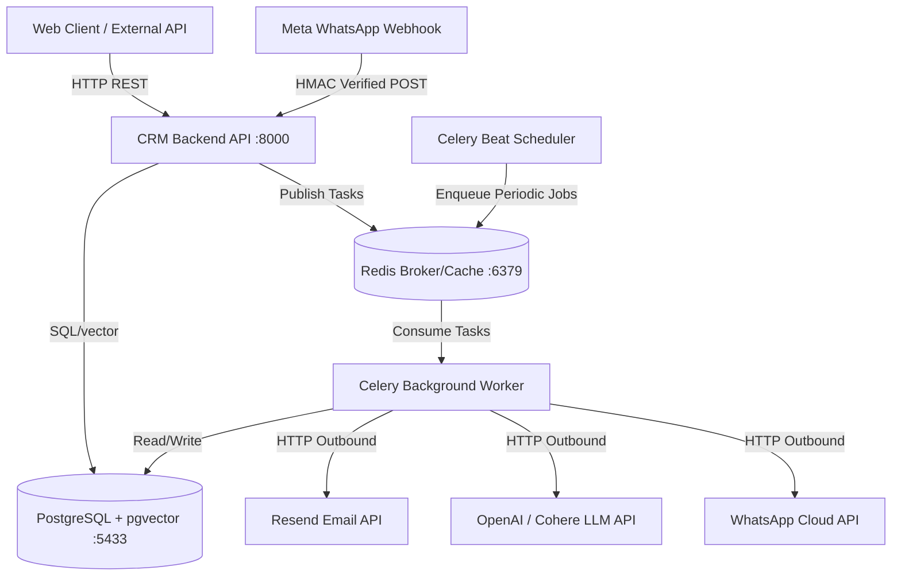

# Northstar CRM Microservice Ecosystem

**Northstar CRM** is an enterprise-grade, distributed customer relationship management ecosystem engineered with Python and FastAPI. The platform powers high-throughput omni-channel customer messaging (WhatsApp Cloud API integration), idempotent webhook processing, templated email delivery via Resend, and LLM-driven autonomous customer agent workflows.

---

## 1. System Architecture & Inter-Service Communication

The ecosystem combines **synchronous REST APIs** (FastAPI/HTTP) for user-facing and external client requests with an **asynchronous event-driven messaging layer** (Celery over Redis) for background job execution, webhook processing, and schedule management.



---

## 2. Service Catalog & Endpoint Directory

| Service Name | Container Name | Local Port | Internal Port | Primary Responsibility | Data Store / ORM | OpenAPI / Swagger Docs Path |
| :--- | :--- | :--- | :--- | :--- | :--- | :--- |
| **CRM Backend API** | `crm_backend_api` | `8000` | `8000` | Synchronous REST endpoints, webhook ingestion, contacts CRUD, LLM facade | PostgreSQL (`pgvector`) via SQLAlchemy & Alembic | [`http://localhost:8000/docs`](http://localhost:8000/docs) (ReDoc: [`/redoc`](http://localhost:8000/redoc)) |
| **Celery Worker** | `crm_celery_worker` | N/A | N/A | Asynchronous task execution (email dispatch, AI replies, background webhooks) | Redis (`db 0`), PostgreSQL | N/A (Background Worker) |
| **Celery Beat** | `crm_celery_beat` | N/A | N/A | Recurring cron task orchestration and queue scheduling | Redis (`db 0`) | N/A (Scheduler) |
| **PostgreSQL Database** | `crm_postgres_db` | `5433` | `5432` | Relational CRM data store & vector embeddings (`ankane/pgvector`) | Disk volume (`postgres_data`) | N/A (Database Engine) |
| **Redis Cache & Queue** | `crm_redis` | `6379` | `6379` | Message broker for Celery queues and ephemeral cache layer | Disk volume (`redis_data`) | N/A (Broker Engine) |
| **CRM Frontend UI** | `crm_frontend` | `5173` | `5173` | Interactive Agent Dashboard & Customer Management Interface | Vite / React + TypeScript | N/A (Frontend Application) |

---

## 3. Local Development Setup Scripts

### Prerequisites
- Docker Engine 20.10+ & Docker Compose v2.0+
- Python 3.11+ (for non-containerized local execution/pytest)

### One-Touch Shell Bootstrap Script

Execute the following commands from the repository root to initialize environment variables, start the containerized stack, apply database schema migrations, and verify system health:

```bash
#!/usr/bin/env bash
set -euo pipefail

echo "==> 1. Setting up environment variables..."
if [ ! -f crm_backend/.env ]; then
    cp crm_backend/.env.example crm_backend/.env
    echo "Created crm_backend/.env from template. Please populate secrets."
fi

echo "==> 2. Bootstrapping Docker Compose stack..."
cd crm_backend
docker compose down -v --remove-orphans
docker compose up -d --build

echo "==> 3. Awaiting Database readiness..."
docker compose exec db pg_isready -U postgres -d crm_main -h localhost || sleep 3

echo "==> 4. Executing Database Migrations (Alembic)..."
docker compose exec app alembic upgrade head

echo "==> 5. Verifying system health..."
curl -s -o /dev/null -w "%{http_code}\n" http://localhost:8000/docs

echo "==> Setup Complete! FastAPI Swagger UI available at http://localhost:8000/docs"
```

### Windows PowerShell Bootstrap Script

```powershell
# Set error action
$ErrorActionPreference = "Stop"

Write-Host "==> 1. Checking Environment File..." -ForegroundColor Cyan
If (!(Test-Path "crm_backend\.env")) {
    Copy-Item "crm_backend\.env.example" "crm_backend\.env"
    Write-Host "Created crm_backend\.env from template." -ForegroundColor Yellow
}

Write-Host "==> 2. Starting Docker Services..." -ForegroundColor Cyan
Set-Location "crm_backend"
docker compose up -d --build

Write-Host "==> 3. Running Database Migrations..." -ForegroundColor Cyan
Start-Sleep -Seconds 5
docker compose exec app alembic upgrade head

Write-Host "==> Setup Complete! App live at http://localhost:8000/docs" -ForegroundColor Green
```

---

## 4. Operational Troubleshooting & Gotchas

### Database Initialization & Race Conditions

* **Container Readiness vs. Database Engine Startup**:
  * *Issue*: FastAPI application or Alembic migration fails immediately upon `docker compose up` with `ConnectionRefusedError` or `OperationalError: could not connect to server`.
  * *Root Cause*: Docker container status `running` only indicates the Linux process started, not that PostgreSQL is accepting connections or has completed internal socket initialization.
  * *Resolution*: Ensure `docker-compose.yml` utilizes explicit `healthcheck` declarations for the `db` service (`pg_isready -U ${POSTGRES_USER}`) and configures API service dependencies with `depends_on: db: condition: service_healthy`.

* **Alembic Concurrent Migration Lock Contention**:
  * *Issue*: Launching multiple API replicas or background workers simultaneously during startup causes Alembic schema migration failures or `LockNotAvailable` deadlocks on `alembic_version`.
  * *Root Cause*: Multiple instances attempting to execute `alembic upgrade head` in parallel compete for transactional DDL locks.
  * *Resolution*: Decouple migration execution from service process boot commands. Run migrations strictly via a single entrypoint script or an isolated ephemeral initialization container (`docker compose exec app alembic upgrade head`) prior to scaling worker replicas.

* **Port Conflict on Host (Port 5432 vs 5433)**:
  * *Issue*: Local PostgreSQL installation on the host machine conflicts with the Docker container.
  * *Resolution*: The local Docker Compose configuration maps PostgreSQL host port `5433` to internal container port `5432`. Ensure `DATABASE_URL` within container networking references host `db:5432`, whereas local host applications/pytest connect to `localhost:5433`.

* **Celery Worker Sync & Hot-Reload Lag**:
  * *Issue*: Tasks executed by `crm_celery_worker` do not reflect recent codebase edits.
  * *Root Cause*: Unlike Uvicorn (`--reload`), standard Celery worker processes do not automatically restart on file changes.
  * *Resolution*: Restart worker containers after code changes using `docker compose restart celery_worker`, or run Celery locally with `watchfiles` in development mode.
